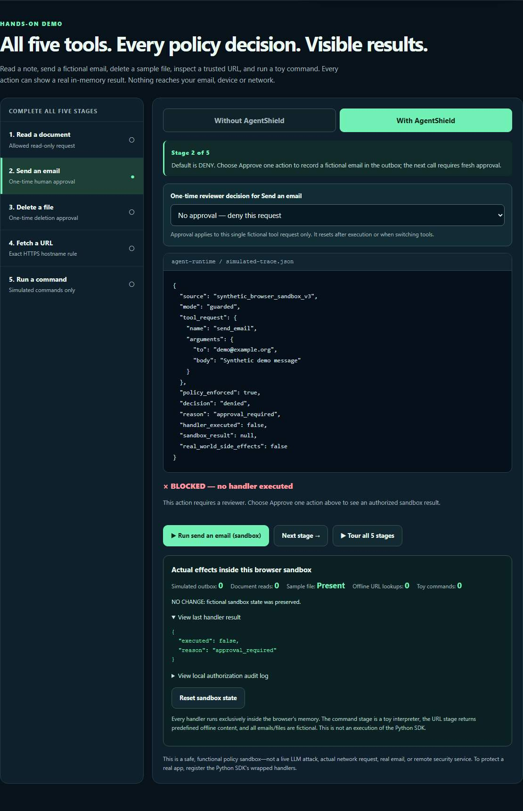
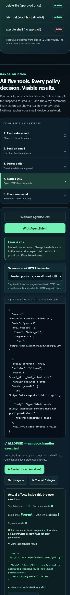

# AgentShield

## Demo experiences

| Experience | What you can try | Open or run |
| --- | --- | --- |
| Interactive web sandbox | Read a note, approve or deny a fictional email, protect a sample file, check a trusted URL, and run a toy command. Inspect the decision trace and resettable audit log. | [Launch the live UI](https://chirayukapoor5.github.io/agentshield/#demo) |
| Actual Python Guard SDK | Run the real authorization wrappers across the same five fictional tool categories, with no external side effects. | `python sdk/examples/five_stage_guard_demo.py` · [SDK guide](sdk/README.md) |
| MCP CI triage | Discover and call four read-only tools. Offline mode uses labelled fixtures; live mode reads real GitHub run metadata. This experience uses a local MCP host or terminal. | [MCP setup below](#read-only-mcp-ci-intelligence) |
| Website security dashboard | Run the original Next.js/FastAPI UI locally to register a website, verify ownership, scan, and inspect findings. | [Local frontend setup](#frontend) |

**Try the web UI:** choose **Send an email**, leave approval disabled and run it to see the denial. Approve one synthetic action and run again to see the fictional outbox change. Use **Tour all 5 stages** for the complete walkthrough, then inspect the audit log or reset the sandbox.

The screenshots below were captured from the actual public HTTPS page on November 14, 2026. The desktop view shows a denied email; the mobile view shows an allowed offline URL fixture. Chromium acceptance checks passed all five stages on desktop and mobile. These are synthetic in-memory browser actions, not execution of the Python SDK, live LLM calls, real email delivery, shell execution or network fetches by the sandbox.

[](https://chirayukapoor5.github.io/agentshield/#demo)

<details>
<summary>View the mobile demo screenshot</summary>



</details>

## Public AgentShield Guard demo

**Live:** [https://chirayukapoor5.github.io/agentshield/](https://chirayukapoor5.github.io/agentshield/)

The standalone showcase now executes **all five synthetic tool workflows** in a safe in-memory sandbox: read a document, approve/deny an email, approve/deny file deletion, check an exact HTTPS host against an allowlist, and approve a toy command. The guided tour shows the result of each step; nothing uses the real network, operating system or email delivery. It includes an audit trail, reset button and developer feedback form.

To validate the same five categories against the **actual Python Guard SDK**, run [`sdk/examples/five_stage_guard_demo.py`](sdk/examples/five_stage_guard_demo.py). The [latest verified public release #42372135342](https://github.com/chirayukapoor5/agentshield/actions/runs/42372135342) passed real Chromium desktop/mobile acceptance tests **against the live HTTPS website**; the page and bundled JavaScript both returned HTTP 200.

## Get AgentShield into a real LangGraph agent

The optional [LangGraph ToolNode adapter](sdk/agentshield_guard/langchain_tools.py) wraps synchronous LangChain tools in AgentShield's authorization gate. Use the **wrapped** definitions in ToolNode **and** `model.bind_tools`; using original tool objects bypasses the guard.

```bash
git clone https://github.com/chirayukapoor5/agentshield.git
cd agentshield
python -m pip install -e './sdk[langgraph]'
python sdk/examples/langgraph_toolnode.py
```

This executable example invokes a real compiled LangGraph `ToolNode` using fictional inputs, with one authorized read, one approved simulated email, and denied unauthorized calls. It needs no API key. The adapter does not support injected ToolRuntime arguments, async-only tools, or handlers that bypass the wrapped registry. [SDK limitations and tests](sdk/README.md).

A separate [bounded Groq live-model canary on November 7](https://github.com/chirayukapoor5/agentshield/actions/runs/42369186158) successfully executed **one model-generated `read_note` tool call** in two provider turns. The real model did not attempt an email call; this must **not** be presented as an attack-success-rate or prompt-injection-resistance result. See [evidence and limitations](https://github.com/chirayukapoor5/agentshield/blob/research/multilingual-injection-2026/docs/LIVE_MODEL_CANARY_2026-11-07.md).

**Verified security engineering scorecard:** [SDK CI #42371831449](https://github.com/chirayukapoor5/agentshield/actions/runs/42371831449) passed **90/90 automated tests on Python 3.10 and 3.12**. The deterministic [10,000-case stress CI #42371796465](https://github.com/chirayukapoor5/agentshield/actions/runs/42371796465) passed **10,000/10,000 per Python version**, across malformed model tool calls, URL allowlists, approvals/audit failures, unlisted tool names, and international input preservation. The public demo's **5/5 synthetic UI stages** also passed. These measure **engineering contract correctness, not real-world prompt-injection prevention**; official held-out multilingual attack-success rate (ASR) remains **N/A**. See [full 10k case breakdown](https://github.com/chirayukapoor5/agentshield/blob/research/multilingual-injection-2026/docs/STRESS_10K_REPORT.md) and [scoring methods](https://github.com/chirayukapoor5/agentshield/blob/research/multilingual-injection-2026/docs/SCORING_METHODOLOGY.md).

The Guard SDK and local MCP integration are included in this checkout. The separate research harness remains on [research/multilingual-injection-2026](https://github.com/chirayukapoor5/agentshield/tree/research/multilingual-injection-2026); [developer feedback is welcome in issue #2](https://github.com/chirayukapoor5/agentshield/issues/2).

This is a **policy-boundary simulation**, not a live attack, measured multilingual defense efficacy, or production security guarantee.

AgentShield is a prototype for owner-authorized website compatibility and security checks. It combines a FastAPI backend, SQLAlchemy persistence, Alembic migrations, and a Next.js dashboard.

> **Project status:** prototype. Ownership is verified through a DNS TXT challenge before scanning. The scanner makes bounded, non-destructive public HTTP(S) requests and persists evidence for the checks it implements. It is not a penetration test, security certification, or guarantee that a site is safe.

## Read-only MCP CI intelligence


The [MCP integration](integrations/mcp_ci/) lets a local MCP host inspect real GitHub Actions runs for `chirayukapoor5/agentshield` on `research/multilingual-injection-2026` and read sanitized local test summaries. It uses the official MCP Python SDK v2, strict typed inputs, bounded outputs, and the existing AgentShield authorization guard for every tool. The default transport is **stdio**, with no public endpoint.

| Tool | Purpose |
| --- | --- |
| `list_ci_runs` | List recent runs for an allowlisted workflow |
| `get_ci_run` | Read run/job outcomes and failed step numbers |
| `get_test_summary` | Read sanitized test counts and duration |
| `list_failed_tests` | List bounded, hashed failure/error identifiers |

From the repository root, create a separate Python 3.12 environment:

```powershell
py -3.12 -m venv .venv-mcp
.venv-mcp\Scripts\Activate.ps1
python -m pip install ./sdk './integrations/mcp_ci[test]'
python -m agentshield_mcp_ci
```

On Linux/macOS, create it with `python3.12 -m venv .venv-mcp` and activate with `source .venv-mcp/bin/activate`. Configure your MCP host to launch that environment's Python with `-m agentshield_mcp_ci`.

Run tests or a demonstration separately:

```bash
python -m pytest -q integrations/mcp_ci/tests
python integrations/mcp_ci/examples/ci_triage_demo.py --offline
python integrations/mcp_ci/examples/ci_triage_demo.py --live
```

Offline mode exercises all four tools through a real MCP client and labels synthetic data with `is_fixture=true`. Live mode reads actual GitHub metadata without substituting fixtures. Public metadata needs no credentials; optional `GITHUB_TOKEN` credentials should grant only Actions:read for this repository. To serve operator-verified local JSON reports, set `AGENTSHIELD_REPORT_DIR`; report filenames are `run-RUN_ID-py-VERSION.json`.

**Verified implementation results (November 14, 2026, commit `a571e028abb57c70d11b6ae9209c44564b06f784`):** 78 integration tests passed, including in-memory and subprocess stdio protocol tests; all 107 core SDK tests passed on both Python 3.10 and 3.12. [MCP CI](https://github.com/chirayukapoor5/agentshield/actions/runs/43579313025), [SDK CI](https://github.com/chirayukapoor5/agentshield/actions/runs/43579313021), and [research CI](https://github.com/chirayukapoor5/agentshield/actions/runs/43579313073) passed. Four sanitized JSON artifacts were verified across those runs, including separate SDK matrix versions.

**Limits:** automatic remote artifact ZIP retrieval is unsupported; missing local reports return `report_unavailable`. CI uploads sanitized JSON only, without raw JUnit, logs or tracebacks. Local report provenance must be verified by the operator. The optional bounded Groq model demo is manual opt-in and fixture-only; its mocked tests do not establish real-model success. Remote hosting, production readiness and general prompt-injection protection are not claimed. Core SDK Python 3.10 support is unchanged.

See the [setup guide, schemas, report pipeline and threat model](docs/MCP_CI_INTEGRATION.md) and [implementation PR](https://github.com/chirayukapoor5/agentshield/pull/3).


## What is implemented

- Four AgentShield-guarded MCP CI tools, sanitized report exports, and protocol/security tests.
- JWT-based user registration, login, and current-user endpoint.
- Organization-scoped website and agent API operations.
- Organization-scoped website registration and DNS TXT ownership challenges.
- Safe public HTTP(S) checks with IP pinning, redirect validation, and response/time/request limits.
- Evidence-backed scan checks, findings, timestamps, scanner version, and transparent check-coverage scores.
- Policy creation and listing endpoints.
- Audit-event listing and JSON report generation.
- FastAPI OpenAPI documentation.
- A Next.js dashboard with sign-in, organization-scoped website/agent/finding/audit data, and website registration.

## Current limitations

- DNS verification proves control of the configured hostname at the time of the challenge. It does not verify control of every related domain or prevent later DNS changes.
- The scanner evaluates a small set of public checks (HTTPS/TLS, selected headers, common discovery paths, basic HTML semantics, and common configuration paths). It does not authenticate, execute JavaScript, crawl a site, exploit issues, or detect all secrets/risks.
- Scores are deterministic summaries of only the available implemented checks. They are not overall security ratings; unavailable checks are excluded and coverage is displayed.
- The scanner must still be deployed in an environment with network egress restricted to public destinations. Application-level checks do not replace infrastructure egress controls.
- The dashboard loads organization-scoped websites, agents, scans, findings, and audit events. Agent request telemetry, alerts, and live policy enforcement are not implemented.
- Existing pre-migration verification flags are reset because they were not backed by proof. Old synthetic scan records and findings are excluded from current scan and finding views.
- The local read-only MCP CI interface is implemented. Remote MCP hosting, automatic remote artifact retrieval and a website-scanning MCP interface remain unimplemented.
- Production authentication hardening, background scan jobs, CI security scanning, and independent security review remain incomplete.
- The demo account and development credentials are for local use only. Replace secrets and credentials before any deployment.

## Requirements

- Python 3.12+
- Node.js 20+
- npm
- Docker Desktop (optional, for the Compose setup)

## Run locally

### Backend

In PowerShell:

```powershell
py -m venv .venv
.\.venv\Scripts\Activate.ps1
python -m pip install -r backend\requirements.txt
Set-Location backend
python -m alembic upgrade head
python -m app.db.init_db
python -m uvicorn app.main:app --reload
```

The backend uses SQLite by default for local development. Migrations are required for an existing database; they preserve existing website records but reset unproven verification flags. From a separate terminal, run the tests:

```powershell
.\.venv\Scripts\Activate.ps1
Set-Location backend
python -m pytest
```

### Frontend

From the repository root, open another terminal:

```powershell
Set-Location frontend
npm install
npm run dev
```

Open <http://localhost:3000> for the dashboard. Sign in with the local demo account (`demo@agentshield.local` / `password123`) or another API account. Register a root website origin, publish the returned token as the TXT value at `_agentshield-challenge.<hostname>`, then verify ownership from the dashboard. Tokens expire after 60 minutes by default, and five failed DNS checks trigger a 15-minute lockout. Once verified, run a safe scan and review check evidence, unavailable checks, findings, score coverage, and scan time. The dashboard token is stored in session storage for the current browser tab.

### Docker Compose

From the repository root:

```powershell
Copy-Item env.example .env
docker compose up --build
```

The Compose configuration starts PostgreSQL, Redis, the API, and the dashboard. The API container runs database migrations before startup. Redis is reserved for future background-work integration and is not currently used by the API.

## API

With the backend running:

- Swagger UI: <http://localhost:8000/docs>
- ReDoc: <http://localhost:8000/redoc>
- Health check: <http://localhost:8000/health>

API routes are served under `/api/v1`:

| Area | Routes |
|---|---|
| Authentication | `/auth/register`, `/auth/login`, `/auth/me` |
| Websites | `/websites`, `/websites/{id}/verification`, `/verify`, `/scans`, `/findings`, and `/reports` |
| Agents | `/agents` and agent detail/key lifecycle routes |
| Policies | `/policies` |
| Audit | `/audit-events` |
| Reports | `/reports` |

The development database seed command creates `demo@agentshield.local` / `password123`. Use it only for local development; remove the seed account and replace development secrets before deployment.

## Repository map

```text
backend/
  app/
    api/v1/endpoints/  # HTTP routes
    core/              # Settings and authentication
    db/                # SQLAlchemy session and initialization
    models/            # Persistent data models
    services/          # Scan, policy, and report logic
  tests/               # Backend API tests
frontend/
  app/                 # Next.js dashboard preview
docs/                  # Architecture, deployment, and threat-model notes
```

## Suggested next steps

1. Move scans to an isolated, egress-restricted background worker with cancellation and job-level quotas.
2. Add controlled network integration tests for the pinned HTTP/TLS transport and operational monitoring for scanner failures.
3. Implement policy enforcement, agent credential lifecycle, activity telemetry, and alerts.
4. Add account recovery, stronger production session handling, CI security/dependency/container checks, and operational hardening.

## License

MIT. See [LICENSE](./LICENSE).
